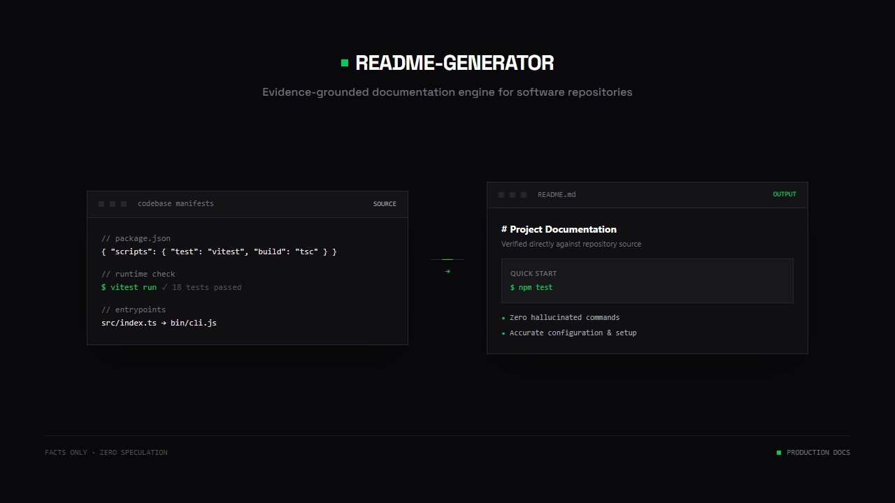

<div align="center">

  <picture>
    <source media="(prefers-color-scheme: dark)" srcset="docs/logo/readme-generator-horizontal-dark.svg" />
    <source media="(prefers-color-scheme: light)" srcset="docs/logo/readme-generator-horizontal-light.svg" />
    
  </picture>

  <p align="center">
    <strong>Generate or update evidence-grounded README.md documentation for any repository without manual guesswork.</strong>
  </p>

  <p align="center">
    <a href="skills/readme-generator/SKILL.md"></a>
    <a href="skills/readme-generator/references/writing-and-style.md"></a>
    <a href="CHANGELOG.md"></a>
    <a href="LICENSE"></a>
  </p>

  <p align="center">
    <a href="#capabilities">Capabilities</a> •
    <a href="#execution-modes--compatibility">Compatibility</a> •
    <a href="#installation">Installation</a> •
    <a href="#usage">Usage</a> •
    <a href="#repository-structure">Structure</a> •
    <a href="#license">License</a>
  </p>

</div>

---



`readme-generator` is a cross-platform AgentSkill and plugin for Antigravity, Claude Code, Codex, and Gemini CLI. It silently inspects codebase facts—runtimes, dependencies, entrypoints, verified scripts, environment keys, and local media—to generate or update production-grade `README.md` documentation aligned with user decisions.

https://github.com/user-attachments/assets/1af09d48-ba50-4788-a016-4b6abf88564e

## Capabilities

- **Codebase-first discovery**: Inspects manifests, entrypoints, scripts, environment variable names, licenses, and local visual assets from real repository files.
- **Collaborative scoping gate**: Pauses before writing to align on target audience, detail depth (minimal vs comprehensive), visual layout, and core highlights in one focused turn.
- **Existing README Diff & Upgrade Report**: Compares valid custom sections against outdated commands, stale paths, and removed environment variables before updating existing documentation.
- **Global readability standards (ESL & WIIFM)**: Enforces Flesch-Kincaid Grade $\le$ 9, active voice, short noun phrases without modifier stacking, and a clear "What's in it for me" opening.
- **Modern GitHub visual presentation**: Supports context-aware Centered Hero Headers with logos, flat-square badges, quick links navigation, GFM callouts (`> [!NOTE]`, `> [!TIP]`, `> [!WARNING]`), and collapsible `<details>` blocks.
- **Anti-duplication & Anti-leakage guardrails**: Uses concise single-line links for `CONTRIBUTING.md`, `CHANGELOG.md`, `LICENSE`, and `SECURITY.md`. Never leaks credentials, database rules, internal schemas, or CI/CD internals.
- **Bilingual output standards**: Generates technical documentation in English or natural Vietnamese with complete diacritics and preserved engineering terms.

## Execution Modes & Compatibility

Compatible with AgentSkills-enabled coding agents without IDE-locked tool constraints: **Antigravity**, **Claude Code**, **Codex**, and **Gemini CLI**.

| Mode | When applied | Behavior |
| :--- | :--- | :--- |
| **Create** | No `README.md` exists yet | Composes sections from verified codebase evidence and matching blueprints |
| **Replace cleanly** | Existing starter boilerplate or stale doc | Rebuilds structure from current repo facts while keeping valid local media |
| **Preserve-and-upgrade** | Existing custom `README.md` | Keeps valid custom sections, badges, and media while updating stale facts |
| **Surgical update** | Targeted section change requested | Modifies only specified outdated or broken sections |

## Installation

### Via Plugin Marketplace (Claude Code, Codex, Antigravity)

Install the repository directly as a plugin:

Claude Code:

```text
/plugin marketplace add dexter826/readme-generator
/plugin install readme-generator@readme-generator
```

Codex:

```bash
codex plugin marketplace add dexter826/readme-generator
codex plugin add readme-generator@readme-generator
```

Antigravity:

```bash
agy plugin install https://github.com/dexter826/readme-generator
```

### Via Skills CLI (Recommended)

Install directly from GitHub using [`skills`](https://skills.sh/).

Project-level installation:

```bash
npx skills add dexter826/readme-generator
```

Global installation (non-interactive):

```bash
npx skills add dexter826/readme-generator -g -y
```

### Manual Installation

Copy only the [`skills/readme-generator`](skills/readme-generator) directory into your agent's skills directory so root repository files are not included.

Global on Unix/macOS (`~/.agents/skills`):

```bash
tmp=$(mktemp -d) && git clone --depth 1 https://github.com/dexter826/readme-generator.git "$tmp" && mkdir -p ~/.agents/skills && rm -rf ~/.agents/skills/readme-generator && cp -R "$tmp/skills/readme-generator" ~/.agents/skills/readme-generator && rm -rf "$tmp"
```

Project-level on Unix/macOS (`.agents/skills`):

```bash
tmp=$(mktemp -d) && git clone --depth 1 https://github.com/dexter826/readme-generator.git "$tmp" && mkdir -p .agents/skills && rm -rf .agents/skills/readme-generator && cp -R "$tmp/skills/readme-generator" .agents/skills/readme-generator && rm -rf "$tmp"
```

Global on Windows PowerShell (`$HOME\.agents\skills`):

```powershell
$tmp = Join-Path ([IO.Path]::GetTempPath()) ([IO.Path]::GetRandomFileName())
git clone --depth 1 https://github.com/dexter826/readme-generator.git $tmp
if ($LASTEXITCODE -eq 0) {
  New-Item -ItemType Directory -Force -Path "$HOME\.agents\skills" | Out-Null
  Remove-Item -Recurse -Force -ErrorAction SilentlyContinue "$HOME\.agents\skills\readme-generator"
  Copy-Item -Recurse "$tmp\skills\readme-generator" "$HOME\.agents\skills\readme-generator"
}
Remove-Item -Recurse -Force -ErrorAction SilentlyContinue $tmp
```

## Usage

Ask your agent to document a repository or invoke `/readme-generator`. The skill silently inspects the codebase, reports findings, and pauses at the Collaborative Scoping Gate to align on audience, scope, layout, and highlights before editing files.

> [!NOTE]
> To bypass confirmation and generate immediately with recommended defaults, include `--non-interactive` or specify `"viết luôn không cần hỏi"`.

### Example Prompts

```text
Create a README.md for this repository
```

```text
Update README.md to match the current FastAPI endpoints and Docker setup
```

```text
Viết file README.md bằng tiếng Việt cho repo này
```

### Repository Structure

```text
readme-generator/
├── README.md                     # Overview, install, and usage
├── CHANGELOG.md                  # Release history
├── LICENSE                       # MIT
├── .editorconfig                 # Editor defaults
├── .gitattributes                # Line endings and binary types
├── .gitignore                    # Ignored local files
├── plugin.json                   # Codex manifest
├── .claude-plugin/               # Claude Code manifest and marketplace
├── .antigravity-plugin/          # Antigravity manifest
├── .agents/plugins/              # Codex marketplace
├── docs/
│   ├── banner.png                # Repository showcase banner
│   └── logo/                     # M.O.B Signal logo assets
├── skills/readme-generator/
│   ├── SKILL.md                  # Workflow and rules
│   ├── references/               # Archetypes, style, and anti-leakage guidance
│   └── assets/blueprints/        # App, library, CLI, monorepo, and plugin blueprints
└── evals/
    └── evals.json                # Evaluation prompts and assertions
```

## License

Distributed under the [MIT](LICENSE) license.
