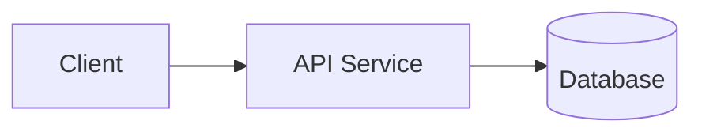

# Blueprint: Applications and Backend Services

Composable section blueprint for standalone applications (web, mobile, desktop) and backend APIs or services. Adapt section titles, language (English or Vietnamese), and commands strictly to verified repository files — omit any section that has no codebase evidence or user confirmation.

## Suggested Section Flow

```markdown
# <Project Name>

<!-- Optional: local logo or verified stack/license badges -->

<1-2 declarative sentences stating what the application or service does and what workflow it supports.>

<!-- Optional: verified screenshot or UI preview when present in docs/ or assets/ -->

## Features

- **<Capability>**: <Concrete action and verifiable scope>
- **<Capability>**: <Concrete action and verifiable scope>

## Architecture <!-- Include only when multiple services/workers/queues interact -->



## Tech Stack <!-- Keep brief; group by verified runtime layers -->

- **Runtime / Language**: <e.g., Python 3.12 / TypeScript 5>
- **Framework**: <e.g., FastAPI / Next.js>
- **Data / Messaging**: <e.g., PostgreSQL / Redis>

## Getting Started

### Prerequisites

- <Verified runtime version from manifest, .nvmrc, pyproject.toml, or Dockerfile>
- <Verified package manager or Docker version if compose is used>

### Local Setup

```bash
# Example (Python / uv) — replace with actual commands from repo manifests
uv sync
cp .env.example .env
uv run uvicorn app.main:app --reload
```

### Running with Docker <!-- Include only when Dockerfile or compose.yaml exists -->

```bash
docker compose up --build
```

## Configuration

Declare required environment variables (sourced from `.env.example` or config schema — never expose real `.env` secrets):

| Variable | Required | Default | Description |
| :--- | :---: | :---: | :--- |
| `PORT` | No | `8000` | HTTP listen port |
| `DATABASE_URL` | Yes | - | Database connection string |

## API Overview <!-- Backend services only: summarize public route groups, never internal auth secrets -->

- Interactive docs: `/docs` (OpenAPI) when running locally
- `GET /health` — Service liveness probe
- `POST /v1/<resource>` — <Verified public action>

## Available Scripts / Commands

| Command | Purpose |
| :--- | :--- |
| `<verified test command>` | Run unit and integration tests |
| `<verified lint command>` | Run static analysis and linting |

## Project Structure <!-- Optional: keep shallow (1-2 levels) and verified on disk -->

```text
.
├── app/       # Application entrypoint and route handlers
├── tests/     # Automated test suite
└── compose.yaml
```

## License <!-- Omit for private repos unless explicitly confirmed -->

Distributed under the [MIT](LICENSE) license.
```
