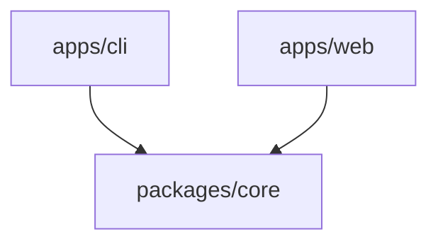

# Blueprint: Monorepos, Plugins, and Agent Skills

Composable section blueprint for multi-package workspaces (monorepos) and extension ecosystems (IDE plugins, AgentSkills, templates). For monorepos, write the root `README.md` as the repository index and link out to sub-packages instead of duplicating every package's full API docs at the root.

## A. Monorepo / Workspace Flow

```markdown
# <Workspace Name>

<1-2 sentences describing the system across its workspace packages and apps.>

## Architecture <!-- Include Mermaid only when workspace dependencies clarify the layout -->



## Workspace Packages

| Package | Path | Role |
| :--- | :--- | :--- |
| `<core-pkg>` | [`packages/core`](./packages/core) | Shared domain logic and types |
| `<cli-pkg>` | [`apps/cli`](./apps/cli) | Command-line interface |

## Getting Started

### Prerequisites

- <Verified toolchain versions across workspace manifests>

### Workspace Commands

```bash
# Install dependencies across workspace
<verified workspace install command>

# Build / test all packages
<verified workspace test/build command>
```

## Configuration & License

- Add environment variable table only if root configuration exists.
- Include `## License` only when verified `LICENSE` exists and repository is not private.
```

## B. Plugin, Extension, or Agent Skill Flow

```markdown
# <Skill or Plugin Name>

<1-2 sentences stating what workflow or capability the skill/plugin adds.>

## Supported Runtimes / Compatibility

- <List only runtimes/hosts verified in skill/plugin manifests, e.g., AgentSkills-compatible coding agents>

## Installation

Provide exact copy, clone, or CLI steps matching how the project is actually distributed (never invent registry commands that do not exist).

## Usage / Triggers

Show realistic user prompts, slash commands, or configuration examples demonstrating when and how the skill or plugin activates.

## Structure

```text
.
├── SKILL.md       # Core instructions and metadata
├── references/    # On-demand guides
└── assets/        # Reusable blueprints or resources
```

## License

Distributed under the [MIT](LICENSE) license.
```
