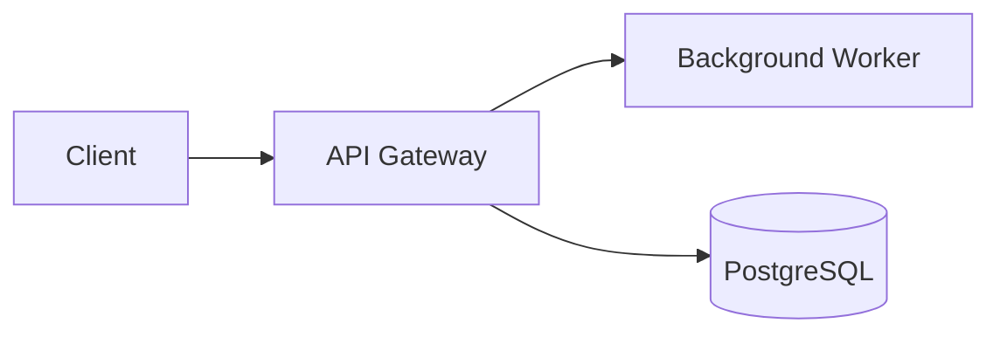

# Blueprint: Applications and Backend Services

Composable section blueprint for standalone applications (web, mobile, desktop) and backend APIs or services. Adapt section titles, language (English or Vietnamese), and commands strictly to verified repository files — omit any section that has no codebase evidence or user confirmation.

## Suggested Section Flow

```html
<div align="center">

<!-- Optional: project logo/icon if available in docs/ or assets/ -->


# <Project Name>

**<1 declarative sentence answering what the app/service does and what's in it for the user (WIIFM).>**

[](LICENSE)
[](package.json)
[](actions)

[Features](#features) • [Quick Start](#quick-start) • [Configuration](#configuration) • [API Overview](#api-overview) • [Contributing](#contributing) • [License](#license)

</div>

---
```

```markdown
<!-- Optional: verified screenshot or UI preview when present in docs/ or assets/ -->


## Features

- **<Core Capability>**: <Concrete action and verifiable scope>
- **<Core Capability>**: <Concrete action and verifiable scope>

## Architecture <!-- Include only when multiple services/workers/queues interact -->



## Tech Stack <!-- Keep brief; group by verified runtime layers -->

- **Runtime / Language**: Python 3.12 / TypeScript 5
- **Framework**: FastAPI / Next.js
- **Data / Cache**: PostgreSQL / Redis

## Quick Start

### Prerequisites

- <Verified runtime version from manifest, .nvmrc, pyproject.toml, or Dockerfile>
- <Verified package manager or Docker version if compose is used>

### Local Setup

```bash
# Example (replace with actual commands from repo manifests)
git clone <repo-url>
cd <repo-name>
npm install
cp .env.example .env
npm run dev
```

> [!TIP]
> You can also run the complete stack with Docker Compose:
> ```bash
> docker compose up --build
> ```

## Configuration

Declare required environment variables (sourced strictly from `.env.example` or config schema — never expose real `.env` secret values):

| Variable | Required | Default | Description |
| :--- | :---: | :---: | :--- |
| `PORT` | No | `8000` | HTTP listen port |
| `DATABASE_URL` | Yes | - | PostgreSQL connection string |

> [!WARNING]
> Ensure `DATABASE_URL` is configured before executing initial database migrations.

## API Overview <!-- Backend services only: summarize public route groups, never internal auth secrets -->

- Interactive docs: `/docs` (OpenAPI Swagger) when running locally
- `GET /health` — Service liveness probe
- `POST /v1/<resource>` — <Verified public endpoint action>

## Available Scripts

| Command | Purpose |
| :--- | :--- |
| `<verified test command>` | Run unit and integration tests |
| `<verified lint command>` | Run static analysis and linter |
| `<verified build command>` | Compile production bundle |

## Project Structure <!-- Optional: wrap in <details> if extensive -->

<details>
<summary><strong>Directory Layout</strong></summary>

```text
.
├── src/           # Application entrypoint and route handlers
│   ├── api/       # HTTP controllers and endpoints
│   └── services/  # Core business logic
├── tests/         # Automated test suite
└── compose.yaml   # Local container orchestration
```

</details>

## Contributing

Contributions are welcome! See [CONTRIBUTING.md](CONTRIBUTING.md) for local development setup and submission guidelines.

## License <!-- Omit for private repos unless explicitly confirmed -->

Distributed under the [MIT](LICENSE) License.
```
