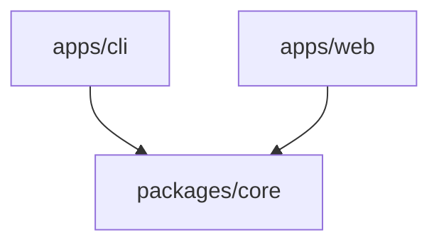

# Blueprint: Monorepos, Plugins, and Agent Skills

Composable section blueprint for multi-package workspaces (monorepos) and extension ecosystems (IDE plugins, AgentSkills, templates). For monorepos, write the root `README.md` as the repository index and link out to sub-packages instead of duplicating every package's full API docs at the root.

## A. Monorepo / Workspace Flow

```html
<div align="center">

<!-- Optional: monorepo logo or banner -->


# <Workspace Name>

**<1 declarative sentence describing the system across its packages and apps (WIIFM).>**

[](LICENSE)
[](actions)

[Architecture](#architecture) • [Packages](#workspace-packages) • [Getting Started](#getting-started) • [Contributing](#contributing) • [License](#license)

</div>

---
```

```markdown
## Architecture <!-- Include Mermaid when workspace dependencies clarify the system -->



## Workspace Packages

| Package | Path | Role |
| :--- | :--- | :--- |
| `<core-pkg>` | [`packages/core`](./packages/core) | Shared domain logic and types |
| `<cli-pkg>` | [`apps/cli`](./apps/cli) | Command-line interface |
| `<web-pkg>` | [`apps/web`](./apps/web) | Web dashboard application |

## Getting Started

### Prerequisites

- <Verified toolchain versions across workspace manifests (e.g., Node.js >= 20, pnpm >= 9, Go >= 1.22)>

### Workspace Commands

```bash
# Install dependencies across all packages
pnpm install

# Run development mode across workspace
pnpm dev

# Build and test all packages
pnpm build
pnpm test
```

> [!TIP]
> Filter commands to a specific package using `pnpm --filter <pkg-name> <command>`.

## Contributing

Contributions are welcome! See [CONTRIBUTING.md](CONTRIBUTING.md) for local workspace setup and PR submission guidelines.

## License

Distributed under the [MIT](LICENSE) License.
```

---

## B. Plugin, Extension, or Agent Skill Flow

```html
<div align="center">


# <Skill or Plugin Name>

**<1 declarative sentence stating what capability the skill/plugin provides to the agent or IDE (WIIFM).>**

[](LICENSE)
[](plugin.json)

[Overview](#overview) • [Supported Runtimes](#supported-runtimes) • [Installation](#installation) • [Usage](#usage--triggers) • [Structure](#structure) • [License](#license)

</div>

---
```

```markdown
## Overview

<2-3 concise sentences detailing the capabilities and workflows enabled by the skill.>

## Supported Runtimes

- **Antigravity**: Native skill support
- **Claude Code**: Agent skills integration (`~/.claude/skills/`)
- **Codex / ChatGPT**: Standard MCP & skill format

## Installation

```bash
# Clone into your agent's skills directory
git clone <repo-url> <agent-skills-directory>/<skill-name>
```

## Usage & Triggers

Use natural language prompts to activate the skill:

- *"Create a comprehensive README for this repository"*
- *"Update our project README after the latest refactoring"*

> [!NOTE]
> The skill automatically inspects repository manifests, scripts, and entrypoints before proposing documentation changes.

## Structure

```text
.
├── SKILL.md       # Core instructions and trigger metadata
├── references/    # In-depth architectural and style guidelines
└── assets/        # Composable templates and blueprints
```

## Contributing

See [CONTRIBUTING.md](CONTRIBUTING.md) for development workflows and testing guidelines.

## License

Distributed under the [MIT](LICENSE) License.
```
